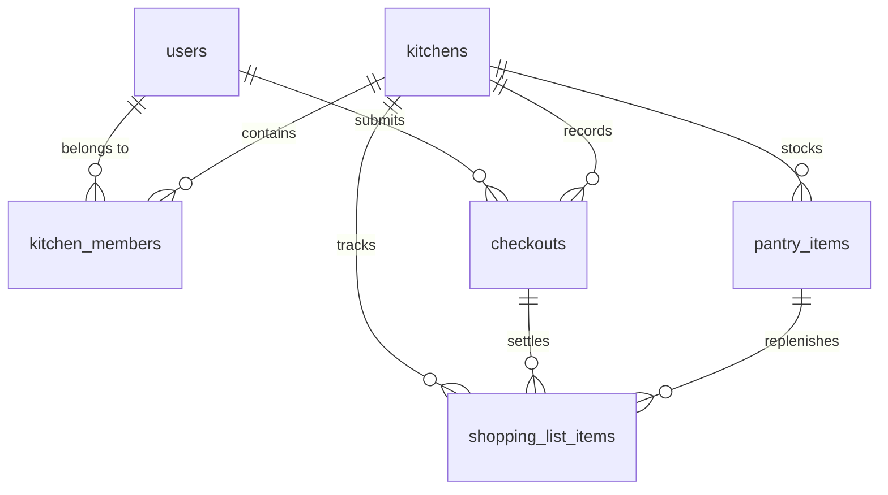

<div align="center">


Shared grocery lists, pantry tracking and receipt splitting for flatshares, families and small teams.

[](https://nextjs.org/)
[](https://react.dev/)
[](https://www.typescriptlang.org/)
[](https://tailwindcss.com/)
[](https://neon.tech/)
[](https://ai.google.dev/)
[](https://authjs.dev/)

</div>

---

## Overview

kartli is a shared kitchen app. Housemates keep one grocery list, track what is in the pantry, and split the cost of a shop by scanning the receipt. Sign-up needs no email address, just a username.

---

## Features

- Shared grocery list for a flat, family, office or neutral space
- Sign up with a username, no email
- Invite links for housemates
- Scan a receipt and items are matched to the cart
- Leave private items out of the split
- Check out without a receipt, with a note for the admin
- Admin view of refund requests with receipt images, one click to settle
- Read-only guest link for someone shopping for you, revocable
- Pantry: mark items out of stock and they go on the list
- Stats: monthly spend, average receipt, spend per store, most-bought items
- Color themes, dark and light
- Push notifications, including iPhone (iOS 16.4+, add to Home Screen)
- English and German

---

## Tech Stack

| Layer | Technology |
| :--- | :--- |
| **Framework** | Next.js (App Router, Server Actions, React 19) |
| **Language** | TypeScript (Strict mode) |
| **Styling & UI** | Tailwind CSS v4, shadcn/ui, Lucide React, Sonner |
| **Database** | PostgreSQL via [Neon Serverless](https://neon.tech/) & `pg` connection pool |
| **Authentication** | Auth.js (NextAuth v5 beta, Credentials provider, stateless JWT sessions) |
| **AI / Multimodal** | Google Gemini Vision (`@google/generative-ai`) |

---

## Database Architecture

Table definitions, foreign keys and indexes are in [db.md](./db.md).



---

## Run it

```bash
git clone https://github.com/randakamal/kartli.git
cd kartli
npm install
cp .env.example .env.local   # fill in DATABASE_URL, AUTH_SECRET, GEMINI_API_KEY, VAPID keys
npm run dev
```

---

## License

This project is available for personal and noncommercial use under the [PolyForm Noncommercial License](LICENSE).
